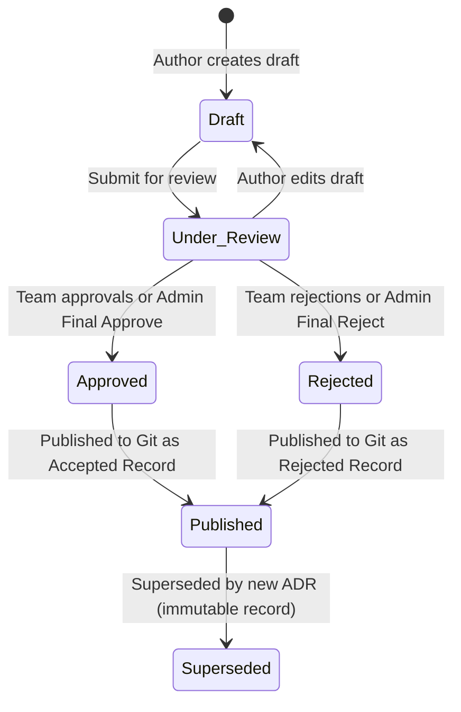

# Decyra — Comprehensive User Manual & Platform Guide

Welcome to **Decyra** (Architecture Hub), the collaborative engineering platform designed for capturing, reviewing, linking, and managing **Architecture Decision Records (ADRs)** across your organization.

This manual provides an end-to-end operational guide for developers, architects, and administrators using Decyra.

---

## Table of Contents
1. [Core Concepts & Mental Model](#1-core-concepts--mental-model)
2. [User Accounts & Authentication](#2-user-accounts--authentication)
3. [Roles & Permission Boundaries](#3-roles--permission-boundaries)
4. [Projects Management](#4-projects-management)
   - [Creating a Project](#creating-a-project)
   - [Configuring Git Repository Integration](#configuring-git-repository-integration)
   - [Editing Projects & Repository Migration](#editing-projects--repository-migration)
   - [Managing Project Members](#managing-project-members)
   - [Project Deletion Governance (3 Approvals & Revocation)](#project-deletion-governance-3-approvals--revocation)
5. [Authoring Architecture Decision Records (ADRs)](#5-authoring-architecture-decision-records-adrs)
   - [Starting an ADR Draft](#starting-an-adr-draft)
   - [ADR Structure & Required Sections](#adr-structure--required-sections)
   - [Split-Pane Editor & Live Markdown Preview](#split-pane-editor--live-markdown-preview)
   - [Context-Aware Similarity Checking (On-Submit Modal)](#context-aware-similarity-checking-on-submit-modal)
   - [Collaborative Editing](#collaborative-editing)
6. [Review, Governance & Publishing Workflow](#6-review-governance--publishing-workflow)
   - [The ADR State Machine](#the-adr-state-machine)
   - [Submitting for Review](#submitting-for-review)
   - [Multiple Reviewers Request & Locking Workflow](#multiple-reviewers-request--locking-workflow)
   - [Revoking Review Requests & Audit Logging](#revoking-review-requests--audit-logging)
   - [Discussions, @ User Mentions & # ADR References](#discussions--user-mentions---adr-references)
   - [Sequential Keyboard Navigation (Arrow Keys)](#sequential-keyboard-navigation-arrow-keys)
   - [Personal Review Decisions & Approval Revocation](#personal-review-decisions--approval-revocation)
   - [Admin Final Decisions & Mandatory Override Rationale](#admin-final-decisions--mandatory-override-rationale)
   - [Activity & Edit Timeline (Audit Trail)](#activity--edit-timeline-audit-trail)
   - [Publishing Accepted & Rejected Decisions to Git](#publishing-accepted--rejected-decisions-to-git)
   - [Immutability of Finalized ADRs & The Supersede Pattern](#immutability-of-finalized-adrs--the-supersede-pattern)
7. [Git Integration & Two-Way Sync](#7-git-integration--two-way-sync)
   - [Importing ADRs from a Git Repository](#importing-adrs-from-a-git-repository)
   - [ADR Identifier Format: `[Project code-ADR-XXX]`](#adr-identifier-format-project-code-adr-xxx)
   - [GitHub Two-Way Push Sync](#github-two-way-push-sync)
8. [Relationship Graph & Visual Dependency Editor](#8-relationship-graph--visual-dependency-editor)
   - [Directional Arrows & Relationship Semantics](#directional-arrows--relationship-semantics)
   - [Interactive Visual Graph Editing (Drag-to-Connect)](#interactive-visual-graph-editing)
   - [Custom Layouts & Persistence](#custom-layouts--persistence)
   - [Light Mode & Dark Mode High-Contrast Styling](#light-mode--dark-mode-high-contrast-styling)
9. [Project Data Archives (Export & Import)](#9-project-data-archives-export--import)
10. [Global Search & Knowledge Discovery](#10-global-search--knowledge-discovery)

---

## 1. Core Concepts & Mental Model

- **Architecture Decision Record (ADR)**: A lightweight, structured document capturing an important architectural decision, why it was made, and its consequences.
- **Project**: The boundary container for a software system or domain. Every ADR belongs to a project and receives an auto-generated unique identifier based on the project's code (e.g. `DEC-ADR-001`).
- **Git as Single Source of Truth**: When published, ADRs are automatically generated as standardized Markdown files and committed/pushed to your Git repository.
- **Governance by Consensus**: Decisions and critical actions (such as ADR publishing and project deletion) require formal team approvals before execution.
- **Workspace Ergonomics (Collapsible Sidebar)**: To maximize reading and editing space on wide displays or laptops, the left sidebar can be collapsed into a compact icon rail. Hovering over the collapsed rail smoothly expands the full navigation panel on demand without shifting page content. Use the header button or press `Cmd+B` / `Ctrl+B` to toggle between collapsed and pinned modes. Your preference is automatically persisted.

---

## 2. User Accounts & Authentication

### Sign In
You can log in to Decyra using **either** of the following:
1. Your registered **Email Address** + Password.
2. Your unique **Username** + Password.

### Initial Platform Setup
Upon first installation, when no platform administrator exists, visiting the platform presents the **Platform Setup** wizard. The first registered user automatically becomes the global **Platform Admin**.

### Password Reset
- If a user loses their password, a platform administrator can run the CLI command:
  ```bash
  npm run reset-password <email-or-username> <new-password>
  ```
- Alternatively, users can reset their password on the login screen using their 16-character account recovery key.

---

## 3. Roles & Permission Boundaries

Decyra uses a two-tier role hierarchy: **Platform Roles** and **Project Membership Roles**.

| Role | Scope | Capabilities |
| :--- | :--- | :--- |
| **Platform Admin** | Global | Complete administrative authority across all projects, users, settings, and ADRs. Can delete projects once 3 approvals are reached. |
| **Project Admin** | Project | Manages project settings, members, Git synchronization, ADR publishing, and project deletion (once approved). |
| **Engineer** | Project | Can draft new ADRs, participate in discussions, approve/reject ADRs, and approve/revoke project deletion. |
| **Intern / Read-Only** | Project | Can view project ADRs and participate in discussion threads, but **cannot** approve ADRs or project deletions. |

---

## 4. Projects Management

### Creating a Project
1. Navigate to **Projects** in the top navigation bar.
2. Click **New Project**.
3. Provide the project details:
   - **Project Name**: e.g., `Decyra Platform`
   - **Project Code**: A short uppercase prefix (e.g., `DEC` or `CORE`). This prefix is permanently used to identify ADRs (e.g., `DEC-ADR-001`).
   - **Description**: Summary of the system or architecture domain.
   - **Required Approvals**: The number of approvals required to approve and publish ADRs (default: `3`).
   - **Git Repository URL** *(optional)*: Remote HTTPS repository URL (e.g., `https://github.com/org/repo.git`).
   - **Git Branch** *(optional)*: Monitored branch (e.g., `main`).
   - **ADR Path** *(optional)*: Folder where ADR Markdown files are stored (e.g., `docs/adr` or `/` for repository root).
   - **Git Personal Access Token (PAT)** *(optional)*: Token with write permissions to commit published ADRs.

---

### Configuring Git Repository Integration
Decyra supports GitHub, GitLab, Bitbucket, and private Git servers over HTTPS:
- **Root Repository Support**: Set the ADR path to `/`, `./`, or leave it blank if ADRs are stored directly in the repository root.
- **Subdirectory Support**: Specify paths like `docs/adr` or `architecture/decisions`.
- **Token Security**: Tokens are securely encrypted on the server and redacted from all error logs and client bundles.

---

### Editing Projects & Repository Migration
When editing project information:
1. Open the project and click **Edit**.
2. **Mandatory Git Token**: If your project has a Git repository configured, you **must re-enter or supply your Git Personal Access Token** whenever editing project settings. This verifies your authority to push to the repository.
3. **Automatic Repository Migration**: If you change any Git details (**Repository URL**, **Branch**, or **ADR Path**), Decyra automatically triggers a full repository migration:
   - Clones the target repository and checks out the destination branch.
   - Re-renders and commits all published ADRs into the new repository and path.
   - Updates all ADR repository tracking records in the database.

---

### Managing Project Members
Project Admins and Platform Admins can manage team access:
1. On the Project Details page, scroll to the **Members** section.
2. Select a registered user from the dropdown.
3. Assign a role (`project_admin`, `engineer`, or `intern`).
4. Click **Add Member**.
5. To change a role or remove access, click the role badge or remove button on the member row.

---

### Project Deletion Governance (3 Approvals & Revocation)

Deleting a project is permanent and irreversible (erasing all ADRs, comments, and member relationships). To protect systems from accidental or unilateral destruction, Decyra enforces a **3-Approval Deletion Policy**:

1. **Initiating Deletion**: Any Platform Admin, Project Admin, or Engineer can initiate or review project deletion by clicking the **Delete** button in the project header.
2. **Active Deletion Banner**: When one or more deletion approvals are submitted, a prominent banner appears at the top of the project page notifying all team members:
   > ⚠️ **Project Deletion Approvals in Progress** — `X / 3 Approvals`
3. **Approving Deletion**:
   - Platform Admins, Project Admins, and Engineers can click **Approve Deletion** either from the banner or inside the Delete Modal.
   - Interns are not permitted to approve project deletion.
4. **Revoking Approvals**:
   - If an approver changes their mind or deletion was proposed by mistake, they can click **Revoke My Approval** at any time. The counter decrements immediately.
5. **Permanent Deletion Execution**:
   - The **"Delete project permanently"** button remains strictly **disabled** until **at least 3 unique approvals** are recorded.
   - Once 3 approvals are reached, only an authorized **Platform Admin** or **Project Admin** can click the button to permanently delete the project.

---

## 5. Authoring Architecture Decision Records (ADRs)

### Starting an ADR Draft
1. Navigate to the project page and click **New ADR**.
2. Provide a descriptive title (e.g., `Adopt PostgreSQL for Architecture Persistence`).
3. Add searchable tags (e.g., `database`, `postgres`, `persistence`).

*Empty project? Click **Generate Example ADR** on a new project to generate a realistic ADR demonstrating all fields and best practices.*

---

### ADR Structure & Required Sections

Decyra follows the industry-standard Architecture Decision Record template:

| Section | Required? | Purpose |
| :--- | :---: | :--- |
| **Title** | Yes | Clear, concise summary of the decision. |
| **Context** | Yes | The technical context, forces, and problem statement driving the decision. |
| **Decision** | Yes | The architectural change or standard agreed upon. |
| **Consequences** | Yes | The positive outcomes, trade-offs, risks, and negative consequences. |
| **Alternatives Considered** | No | Other options evaluated and reasons for their rejection. |
| **Design Changes** | No | Specific modifications across APIs, Workflows, Services, Infrastructure, and Data Models. |
| **Major Impacts** | No | Impacts on Operations, Testing, Security, Documentation, and Scalability. |
| **References** | No | Links to Pull Requests, Git Commits, Design Docs, Wikis, and External Standards. |

---

### Split-Pane Editor & Live Markdown Preview
- The editor features side-by-side editing and live rendered preview.
- Supports GitHub Flavored Markdown (tables, checklists, code syntax highlighting, blockquotes).
- Toolbar shortcuts allow quick insertion of headings, bold/italic text, code blocks, lists, and links.

---

### Context-Aware Similarity Checking (On-Submit Modal)

To prevent fragmented or conflicting architectural guidelines across the project, Decyra evaluates new ADR submissions for similarity against existing records:
- **Intelligent Scope & Semantic Analysis**: Instead of intrusive warnings while typing, similarity checking evaluates the entire document—including the **Title**, **Context**, **Decision**, and **Consequences**—scoped within the current project while filtering out common grammatical and system stop words.
- **On-Submit Confirmation Modal**: When you click **Save Draft** or **Submit for Review**, if existing ADRs have substantial similarity (score $\ge 50\%$), Decyra opens an interactive warning dialog.
- **Side-by-Side Review**: The dialog presents matching ADRs with their identifier, title, status, and similarity score percentage. Authors can inspect existing decisions to confirm whether their proposal is genuinely new, or cancel to avoid redundant engineering efforts.

---

### Collaborative Editing
Multiple team members can open the same draft ADR simultaneously. Decyra uses real-time CRDT synchronization via Yjs, displaying active collaborator cursors and preventing conflicting overwrites.

---

## 6. Review, Governance & Publishing Workflow

### The ADR State Machine



1. **Draft**: Active authoring state. Authors can freely modify content.
2. **Under Review**: Draft is frozen and submitted for team review.
3. **Approved**: The required number of positive approvals has been achieved, or an admin issued a Final Approval.
4. **Rejected**: Team or admin declined the decision.
5. **Published**: Immutable, permanent historical record committed directly to your Git repository.
6. **Superseded**: Deprecated by a newer architectural decision via a formal supersede link.

---

### Submitting for Review
When drafting is complete, click **Submit for Review**. This transitions the status to `under_review` and invites project engineers to review the decision.

---

### Multiple Reviewers Request & Locking Workflow

Decyra allows requesting formal peer reviews from multiple team members simultaneously:
1. **Requesting Reviewers**:
   - In the right sidebar under **Reviewers**, choose any project engineer or administrator from the dropdown to assign them as a requested reviewer.
   - You can add multiple reviewers to an ADR.
   - Each reviewer receives an in-app notification and an activity log entry is recorded in the ADR timeline.
2. **Review Status Badges**:
   - Every requested reviewer is displayed with their avatar, name, and live review status:
     - 🕒 **Pending**: Awaiting their review vote.
     - ✅ **Approved**: The reviewer has submitted an approval.
     - ❌ **Changes Req**: The reviewer has requested modifications or rejected the decision.
3. **Review Decision Lock (Hard Blocker)**:
   - **Critical Rule**: As long as **any requested reviewer** has a status of **Pending**, **no one can make the final call—not even platform or project administrators**.
   - While reviews are pending, the **Final Approve**, **Final Reject**, and **Publish** buttons are strictly locked with a warning notice:
     > ⚠️ **Decision Locked by Pending Reviews**: Waiting for `@reviewer`. Till they make their decision or an admin/requester revokes their review request, no final decision can be made.
4. **Automatic Review Completion**:
   - When a requested reviewer submits their review (**Approve** or **Reject**), their request status automatically updates from `Pending` to `Completed`, unlocking the workflow once all requested reviewers have voted.

---

### Revoking Review Requests & Audit Logging

If a requested reviewer is unavailable (e.g., on leave, reassigned, or the review is no longer required), their review request can be revoked:
- **Who Can Revoke**:
  - The user who originally requested the review
  - Platform Administrators
  - Project Administrators
  - The ADR Author
  - The Reviewer themselves
- **How to Revoke**:
  - Click the **✕** button next to the reviewer in the **Reviewers** sidebar card.
  - Revoking the request immediately removes the pending lock and allows final decisions to proceed.
- **Audit Logging**:
  - Revocation is strictly audited: Decyra automatically posts a timeline comment (`📋 Revoked review request for @reviewer by @user.`) and logs a permanent `review_request_revoked` event in the Activity Timeline.

---

### Discussions, @ User Mentions & # ADR References

- **Tagging Team Members with `@`**: Type `@` in any comment to open an autocomplete popup listing project team members. Selecting a user inserts `@username`. Mentioned users receive real-time notifications in their notification inbox with direct links to the ADR.
- **Referencing ADRs with `#`**: Type `#` in any comment to open an interactive autocomplete popup of ADRs in the current project. Selecting an ADR inserts `#PROJECT-ADR-XXX: Title`. Readers can click the reference to navigate directly to the referenced decision.
- **Comment Resolution**: Any team member can resolve actionable discussion feedback by clicking **Resolve**. Resolved comments display a green badge showing who resolved the comment, while keeping discussion histories intact. Resolved comments can be reopened at any time.

---

### Sequential Keyboard Navigation (Arrow Keys)

When reviewing decisions across a project, Decyra provides fast sequential navigation:
- **Previous / Next ADR Buttons**: The page header displays quick navigation buttons (`←` and `→`) along with your current index (`ADR X of Y`).
- **Keyboard Shortcuts**: Press the left arrow key (`←`) to navigate to the previous ADR, or the right arrow key (`→`) to advance to the next ADR. Shortcut navigation is automatically suspended when typing in input or comment fields.

---

### Personal Review Decisions & Approval Revocation

Every project member can participate in peer reviews:
- **Personal Decision**:
  - Click **Approve** to record support, or **Reject** to request modifications.
  - Reviewers can include an optional note detailing their feedback.
- **Revoking Personal Decisions**:
  - If a reviewer wishes to withdraw their approval or rejection, they can click **Revoke Decision**.
  - Withdrawing a decision immediately decrements the approval count and is timestamped in the audit timeline (e.g., `Withdrew approval at 04:15 PM`).

---

### Admin Final Decisions & Mandatory Override Rationale

Decyra cleanly separates peer review feedback from executive architectural governance:
- **Two Separate Decision Panels**:
  1. **Personal Decision**: Used by all project members (including admins in their individual engineering capacity) to cast personal review votes.
  2. **Admin Decision**: Exclusively visible to **Project Admins** and **Platform Admins** to issue authoritative final rulings.
- **Authoritative Approval & Rejection**:
  - Admins can click **Final Approve** or **Final Reject** to authoritatively set the ADR status, irrespective of the current vote count.
  - If an admin personally voted to reject an ADR, their personal vote remains permanently recorded as `Rejected` in the review audit trail, while their administrative decision notes `(Overrode Personal Rejection)`.
- **Mandatory Custom Rationale for Overrides & Auto-Appended System Audit**:
  - When an admin executes an administrative override (e.g., approving an ADR with insufficient approvals, overriding existing rejections, or overriding their own personal rejection), entering a **detailed custom rationale comment (at least 2 sentences / 60 characters and 10+ unique words)** is strictly mandatory.
  - To prevent rubber-stamping, auto-drafting is disabled for overrides; canned phrases, single sentences, and unedited template placeholders are rejected by both client and server validation.
  - When submitted, Decyra automatically formats and appends the project vote statistics and official system audit notice directly to the recorded comment:
    > *🏛️ [Admin Final Approval] <Admin's custom rationale>*\
    > *> 📋 **System Audit Notice**: This project requires 3 approvals (Current status: 1 approval(s), 0 rejection(s)). Decision enacted via Administrative Override.*

---

### Activity & Edit Timeline (Audit Trail)

Decyra provides a comprehensive, immutable audit log for every ADR in the **Activity & Edit Timeline** section:
- **Who Edited**: Displays the actor's avatar, full name, and `@username`. If changes originated from Git repository synchronization, it indicates `Git Sync`.
- **What Was Edited**: Clearly flags which specific sections were modified using highlighted badges (e.g., `Title`, `Context`, `Decision`, `Consequences`, `Alternatives`, `Tags`, `Design Changes`, `Major Impacts`, `References`).
- **When**: Records exact timestamps (e.g., `Oct 29, 2026, 4:21 PM`) for full auditability and traceability.
- **Status & Review Milestones**: Captures lifecycle milestones including draft creation, status transitions, reviewer requests, request revocations, approvals, change requests, comment resolutions, and version publishing.
- **Git Commit Linkage**: When ADRs are published or synchronized from Git, the timeline records the Git commit hash and repository path.

---

### Publishing Accepted & Rejected Decisions to Git

- **Publishing Accepted Decisions**: Once an ADR is approved, a Project Admin or Platform Admin clicks **Publish ADR to Git**. Decyra compiles the decision into standardized Markdown and pushes it to the configured branch.
- **Publishing Rejected Decisions**: In modern software engineering, documenting *why* an architectural alternative was rejected is just as vital as recording what was accepted. Admins can click **Publish Rejected ADR** to push rejected proposals to Git, creating a permanent historical record that prevents future teams from repeating evaluated trade-offs.

---

### Immutability of Finalized ADRs & The Supersede Pattern

**Why Finalized ADRs Cannot Be Overwritten or Edited:**
An Architecture Decision Record is a historical document that captures a specific decision made at a specific point in time under specific constraints. Altering a finalized or published document destroys the historical context of why the system was designed the way it was.

Consequently, Decyra enforces strict **immutability** on published ADRs:
- Published records cannot be edited, overwritten, or republished in place.
- To change or replace an architectural decision, use the industry-standard **Supersede Workflow**:
  1. **Create a New ADR**: Author a new decision document explaining the new context, requirements, and reasons for the change (e.g., `0015-use-postgresql.md`).
  2. **Link the Documents**: In the **Relationships** section of the new ADR, create a `supersedes` link pointing to the older ADR (e.g., `Supersedes ADR-0004`).
  3. **Update Status**: The older ADR transitions its status from `published` to `superseded` with a direct link to the successor decision.

---

## 7. Git Integration & Two-Way Sync

### Importing ADRs from a Git Repository
If you already have ADR files in a Git repository:
1. Open the Project and click **Import ADRs** (or expand **Import Existing ADRs from Git**).
2. Enter the **Source Repository URL**, **Branch**, and **Source ADR Directory**.
   - If ADRs are stored in the root of the repository, enter `/` or leave it blank.
   - If ADRs are stored in a folder, enter e.g. `docs/adr`.
3. Click **Import ADRs**.

---

### ADR Identifier Format: `[Project code-ADR-XXX]`
When importing, Decyra inspects each Markdown file to ensure it matches the project's format:
- **Heading Format**: `# [PROJECT_CODE-ADR-XXX]: Title` or `# PROJECT_CODE-ADR-XXX: Title`
- **Filename Format**: `[PROJECT_CODE-ADR-XXX].md`, `PROJECT_CODE-ADR-XXX.md`, or `PROJECT_CODE-ADR-XXX-title.md`

**What happens during import:**
- Files matching the format and project code (e.g. `DEC`) are parsed, preserving their exact ADR number (`XXX`) and identifier.
- The title is cleaned of duplicate prefix tags.
- Non-ADR files (such as `README.md`, `CONTRIBUTING.md`, or files belonging to another project) are automatically skipped.
- The project's ADR sequence advances to match the highest imported number, ensuring subsequent ADRs never collide.

---

### GitHub Two-Way Push Sync
When enabled, Decyra listens for pushes to your monitored branch:
1. On the project page, under **GitHub Two-Way Sync**, click **Enable Sync**.
2. Decyra generates a unique webhook URL and HMAC secret:
   ```
   Payload URL: https://your-domain/decyra/api/github-sync
   Content type: application/json
   Secret: <generated-hex-secret>
   Events: Just the push event
   ```
3. Copy the URL and secret into your GitHub repository settings under **Webhooks**.
4. Whenever changes to Markdown files are pushed to the monitored branch, Decyra automatically syncs drafts and updates records in Decyra.
5. You can rotate the secret or disable sync at any time.

---

## 8. Relationship Graph & Visual Dependency Editor

Architecture decisions rarely exist in isolation. Decyra provides a full-featured, interactive **Relationship Graph & Architecture Diagrammer** directly in your browser:

### Directional Arrows & Relationship Semantics

In Decyra, every arrow indicates a directional relationship from **Source** &rarr; **Target**:

| Relationship | Meaning in Diagram (`Source ──► Target`) |
| :--- | :--- |
| **`supersedes`** | **Newer replaces Older**: The source decision replaces and obsoletes the target decision. |
| **`replaced by`** | **Older replaced by Newer**: The source decision is superseded and rendered obsolete by the target decision. |
| **`depends on`** | **Prerequisite**: The source decision requires the target decision to be accepted/implemented first. |
| **`affects`** | **Impact**: The source decision impacts or modifies architectural aspects of the target decision. |
| **`conflicts with`** | **Mutual Incompatibility**: The source and target decisions cannot coexist in the system. |
| **`related to`** | **Contextual Association**: The decisions are conceptually or architecturally linked. |

---

### Interactive Visual Graph Editing

You can create, modify, and delete relationships directly on the visual graph canvas without having to open individual ADR pages:
1. **Drag-to-Connect Handles**:
   - Every ADR card in the graph has connection dots (top, bottom, left, and right).
   - Click and drag from any handle on ADR A and drop onto ADR B to connect them.
   - A modal immediately opens displaying the directional arrow `[ADR A] ──► [ADR B]` with a plain-English explanation of the relationship.
   - Choose the relationship type or click **Swap Direction** to invert the arrow.
2. **Editing & Deleting Connections**:
   - Click any connection line or label badge in the graph.
   - Change the relationship type in place, swap its direction, or click **Delete Connection** to remove it.
3. **Manual Connection Dialog**:
   - Click **+ Add Connection** in the top toolbar to choose any two ADRs from dropdowns and establish a relationship.

---

### Custom Layouts & Persistence

- **Save Graph Layout**: Drag ADR cards into custom architectural groupings, pipelines, or clusters. When you reposition cards, the **Save Layout \*** button highlights. Click **Save Layout** to persist your arrangement in the database. When team members view the graph, they see your exact saved layout.
- **Auto Layout**: Click **Auto Layout** at any time to automatically re-organize all cards into a clean, structured grid.

---

### Light Mode & Dark Mode High-Contrast Styling

- The graph canvas automatically synchronizes with Decyra's active color theme (`Light` or `Dark`).
- In **Light Mode**:
  - Cards render with crisp, high-contrast borders and rich status badges.
  - Connection lines and label badges are rendered with solid backgrounds and dark, high-contrast typography so all relationships and text are easily readable.
  - The grid background and mini-map adapt seamlessly to a light canvas.

---

## 9. Project Data Archives (Export & Import)

To move architectural records between projects or environments without full database access:
- **Exporting**: Click **Export Archive** on any project page to download a structured JSON archive containing all ADR contents, design changes, and relationships.
- **Importing**: Click **Import Archive** to import records from an existing JSON archive. Imported records are created as drafts for your team to review.

*(Note: Project archives are intended for content migration; use PostgreSQL backups for full database disaster recovery).*

---

## 10. Global Search & Knowledge Discovery

To locate architectural decisions across your entire company:
1. Click **Search** in the navigation header (or navigate to `/search`).
2. Search by keyword, title, context, or decision text.
3. Filter by:
   - **Project**: Restrict results to specific projects.
   - **Status**: Show only `published`, `approved`, or `under_review` ADRs.
   - **Tags**: Filter by specific technical tags (e.g., `security`, `caching`, `api`).
4. Instant search results display highlighted match snippets and status badges.
