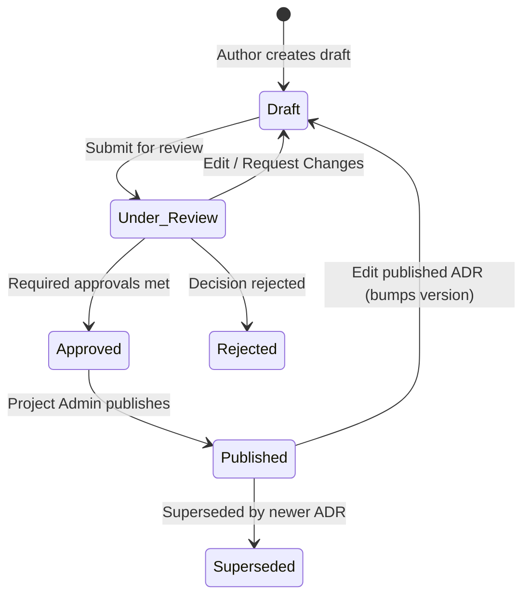

# Decyra — Comprehensive User Manual & Platform Guide

Welcome to **Decyra** (Architecture Hub), the collaborative engineering platform designed for capturing, reviewing, linking, and managing **Architecture Decision Records (ADRs)** across your organization.

This manual provides an end-to-end operational guide for developers, architects, and administrators using Decyra.

---

## Table of Contents
1. [Core Concepts & Mental Model](#1-core-concepts--mental-model)
2. [User Accounts & Authentication](#2-user-accounts--authentication)
3. [Roles & Permission Boundaries](#3-roles--permission-boundaries)
4. [Projects Management](#4-projects-management)
   - [Creating a Project](#creating-a-project)
   - [Configuring Git Repository Integration](#configuring-git-repository-integration)
   - [Editing Projects & Repository Migration](#editing-projects--repository-migration)
   - [Managing Project Members](#managing-project-members)
   - [Project Deletion Governance (3 Approvals & Revocation)](#project-deletion-governance-3-approvals--revocation)
5. [Authoring Architecture Decision Records (ADRs)](#5-authoring-architecture-decision-records-adrs)
   - [Starting an ADR Draft](#starting-an-adr-draft)
   - [ADR Structure & Required Sections](#adr-structure--required-sections)
   - [Split-Pane Editor & Live Markdown Preview](#split-pane-editor--live-markdown-preview)
   - [Real-Time Duplicate Detection](#real-time-duplicate-detection)
   - [Collaborative Editing](#collaborative-editing)
6. [Review, Governance & Publishing Workflow](#6-review-governance--publishing-workflow)
   - [The ADR State Machine](#the-adr-state-machine)
   - [Submitting for Review](#submitting-for-review)
   - [Discussions & Comments](#discussions--comments)
   - [Review Decisions (Approve or Request Changes)](#review-decisions-approve-or-request-changes)
   - [Publishing & Version Snapshots](#publishing--version-snapshots)
   - [Editing Published ADRs](#editing-published-adrs)
7. [Git Integration & Two-Way Sync](#7-git-integration--two-way-sync)
   - [Importing ADRs from a Git Repository](#importing-adrs-from-a-git-repository)
   - [ADR Identifier Format: `[Project code-ADR-XXX]`](#adr-identifier-format-project-code-adr-xxx)
   - [GitHub Two-Way Push Sync](#github-two-way-push-sync)
8. [Relationship Graph & Dependency Mapping](#8-relationship-graph--dependency-mapping)
9. [Project Data Archives (Export & Import)](#9-project-data-archives-export--import)
10. [Global Search & Knowledge Discovery](#10-global-search--knowledge-discovery)

---

## 1. Core Concepts & Mental Model

- **Architecture Decision Record (ADR)**: A lightweight, structured document capturing an important architectural decision, why it was made, and its consequences.
- **Project**: The boundary container for a software system or domain. Every ADR belongs to a project and receives an auto-generated unique identifier based on the project's code (e.g. `DEC-ADR-001`).
- **Git as Single Source of Truth**: When published, ADRs are automatically generated as standardized Markdown files and committed/pushed to your Git repository.
- **Governance by Consensus**: Decisions and critical actions (such as ADR publishing and project deletion) require formal team approvals before execution.

---

## 2. User Accounts & Authentication

### Sign In
You can log in to Decyra using **either** of the following:
1. Your registered **Email Address** + Password.
2. Your unique **Username** + Password.

### Initial Platform Setup
Upon first installation, when no platform administrator exists, visiting the platform presents the **Platform Setup** wizard. The first registered user automatically becomes the global **Platform Admin**.

### Password Reset
- If a user loses their password, a platform administrator can run the CLI command:
  ```bash
  npm run reset-password <email-or-username> <new-password>
  ```
- Alternatively, users can reset their password on the login screen using their 16-character account recovery key.

---

## 3. Roles & Permission Boundaries

Decyra uses a two-tier role hierarchy: **Platform Roles** and **Project Membership Roles**.

| Role | Scope | Capabilities |
| :--- | :--- | :--- |
| **Platform Admin** | Global | Complete administrative authority across all projects, users, settings, and ADRs. Can delete projects once 3 approvals are reached. |
| **Project Admin** | Project | Manages project settings, members, Git synchronization, ADR publishing, and project deletion (once approved). |
| **Engineer** | Project | Can draft new ADRs, participate in discussions, approve/reject ADRs, and approve/revoke project deletion. |
| **Intern / Read-Only** | Project | Can view project ADRs and participate in discussion threads, but **cannot** approve ADRs or project deletions. |

---

## 4. Projects Management

### Creating a Project
1. Navigate to **Projects** in the top navigation bar.
2. Click **New Project**.
3. Provide the project details:
   - **Project Name**: e.g., `Decyra Platform`
   - **Project Code**: A short uppercase prefix (e.g., `DEC` or `CORE`). This prefix is permanently used to identify ADRs (e.g., `DEC-ADR-001`).
   - **Description**: Summary of the system or architecture domain.
   - **Required Approvals**: The number of approvals required to approve and publish ADRs (default: `3`).
   - **Git Repository URL** *(optional)*: Remote HTTPS repository URL (e.g., `https://github.com/org/repo.git`).
   - **Git Branch** *(optional)*: Monitored branch (e.g., `main`).
   - **ADR Path** *(optional)*: Folder where ADR Markdown files are stored (e.g., `docs/adr` or `/` for repository root).
   - **Git Personal Access Token (PAT)** *(optional)*: Token with write permissions to commit published ADRs.

---

### Configuring Git Repository Integration
Decyra supports GitHub, GitLab, Bitbucket, and private Git servers over HTTPS:
- **Root Repository Support**: Set the ADR path to `/`, `./`, or leave it blank if ADRs are stored directly in the repository root.
- **Subdirectory Support**: Specify paths like `docs/adr` or `architecture/decisions`.
- **Token Security**: Tokens are securely encrypted on the server and redacted from all error logs and client bundles.

---

### Editing Projects & Repository Migration
When editing project information:
1. Open the project and click **Edit**.
2. **Mandatory Git Token**: If your project has a Git repository configured, you **must re-enter or supply your Git Personal Access Token** whenever editing project settings. This verifies your authority to push to the repository.
3. **Automatic Repository Migration**: If you change any Git details (**Repository URL**, **Branch**, or **ADR Path**), Decyra automatically triggers a full repository migration:
   - Clones the target repository and checks out the destination branch.
   - Re-renders and commits all published ADRs into the new repository and path.
   - Updates all ADR repository tracking records in the database.

---

### Managing Project Members
Project Admins and Platform Admins can manage team access:
1. On the Project Details page, scroll to the **Members** section.
2. Select a registered user from the dropdown.
3. Assign a role (`project_admin`, `engineer`, or `intern`).
4. Click **Add Member**.
5. To change a role or remove access, click the role badge or remove button on the member row.

---

### Project Deletion Governance (3 Approvals & Revocation)

Deleting a project is permanent and irreversible (erasing all ADRs, comments, and member relationships). To protect systems from accidental or unilateral destruction, Decyra enforces a **3-Approval Deletion Policy**:

1. **Initiating Deletion**: Any Platform Admin, Project Admin, or Engineer can initiate or review project deletion by clicking the **Delete** button in the project header.
2. **Active Deletion Banner**: When one or more deletion approvals are submitted, a prominent banner appears at the top of the project page notifying all team members:
   > ⚠️ **Project Deletion Approvals in Progress** — `X / 3 Approvals`
3. **Approving Deletion**:
   - Platform Admins, Project Admins, and Engineers can click **Approve Deletion** either from the banner or inside the Delete Modal.
   - Interns are not permitted to approve project deletion.
4. **Revoking Approvals**:
   - If an approver changes their mind or deletion was proposed by mistake, they can click **Revoke My Approval** at any time. The counter decrements immediately.
5. **Permanent Deletion Execution**:
   - The **"Delete project permanently"** button remains strictly **disabled** until **at least 3 unique approvals** are recorded.
   - Once 3 approvals are reached, only an authorized **Platform Admin** or **Project Admin** can click the button to permanently delete the project.

---

## 5. Authoring Architecture Decision Records (ADRs)

### Starting an ADR Draft
1. Navigate to the project page and click **New ADR**.
2. Provide a descriptive title (e.g., `Adopt PostgreSQL for Architecture Persistence`).
3. Add searchable tags (e.g., `database`, `postgres`, `persistence`).

*Empty project? Click **Generate Example ADR** on a new project to generate a realistic ADR demonstrating all fields and best practices.*

---

### ADR Structure & Required Sections

Decyra follows the industry-standard Architecture Decision Record template:

| Section | Required? | Purpose |
| :--- | :---: | :--- |
| **Title** | Yes | Clear, concise summary of the decision. |
| **Context** | Yes | The technical context, forces, and problem statement driving the decision. |
| **Decision** | Yes | The architectural change or standard agreed upon. |
| **Consequences** | Yes | The positive outcomes, trade-offs, risks, and negative consequences. |
| **Alternatives Considered** | No | Other options evaluated and reasons for their rejection. |
| **Design Changes** | No | Specific modifications across APIs, Workflows, Services, Infrastructure, and Data Models. |
| **Major Impacts** | No | Impacts on Operations, Testing, Security, Documentation, and Scalability. |
| **References** | No | Links to Pull Requests, Git Commits, Design Docs, Wikis, and External Standards. |

---

### Split-Pane Editor & Live Markdown Preview
- The editor features side-by-side editing and live rendered preview.
- Supports GitHub Flavored Markdown (tables, checklists, code syntax highlighting, blockquotes).
- Toolbar shortcuts allow quick insertion of headings, bold/italic text, code blocks, lists, and links.

---

### Real-Time Duplicate Detection
While you type the ADR title and context, Decyra's background indexing checks existing ADRs across all projects in the workspace. If a similar decision already exists, a warning banner alerts you with clickable links to the existing records, preventing fragmented or duplicated architectural guidelines.

---

### Collaborative Editing
Multiple team members can open the same draft ADR simultaneously. Decyra uses real-time CRDT synchronization via Yjs, displaying active collaborator cursors and preventing conflicting overwrites.

---

## 6. Review, Governance & Publishing Workflow

### The ADR State Machine



1. **Draft**: Active writing state. Authors can freely modify content.
2. **Under Review**: Draft is frozen and submitted for team review.
3. **Approved**: The required number of positive approvals (configured per project) has been achieved.
4. **Published**: Immutable versioned record (`v1`). Decyra formats the Markdown and commits it to Git.
5. **Superseded**: Deprecated by a newer architectural decision.
6. **Rejected**: Decision evaluated but declined by the engineering team.

---

### Submitting for Review
When drafting is complete, click **Submit for Review**. This transitions the status to `under_review` and invites project engineers to review the decision.

---

### Discussions & Comments
- On the ADR detail page, use the **Discussion** tab to ask questions or discuss trade-offs.
- All comments are preserved chronologically with timestamps and author profiles.

---

### Review Decisions (Approve or Request Changes)
- Reviewers click **Approve** to record support, or **Request Changes** to request modifications.
- Decyra displays real-time progress:
  - Progress bar showing `Current Approvals / Required Approvals`.
  - List of approving team members with timestamps.
  - List of reviewers requesting changes.

---

### Publishing & Version Snapshots
- Once approvals reach the project threshold, the ADR enters `Approved` state.
- A **Project Admin** or **Platform Admin** clicks **Publish ADR**.
- Decyra compiles the record into standardized Markdown:
  ```markdown
  # [PROJECT_CODE-ADR-XXX]: Title
  
  **Status:** published
  **Date:** YYYY-MM-DD
  **Tags:** tag1, tag2
  
  ## Context
  ...
  ```
- If a Git repository is configured, Decyra commits the file directly to your branch.
- The snapshot is saved as `v1` (or `v2`, `v3`).

---

### Editing Published ADRs
Published ADRs cannot be directly modified in place. Clicking **Edit** on a published ADR:
1. Bumps the ADR back to `Draft` mode for revision.
2. Retains the previous version snapshot in the **Version History** tab.
3. Re-submits the updated proposal through the review and approval workflow before publishing the next version (`v2`).

---

## 7. Git Integration & Two-Way Sync

### Importing ADRs from a Git Repository
If you already have ADR files in a Git repository:
1. Open the Project and click **Import ADRs** (or expand **Import Existing ADRs from Git**).
2. Enter the **Source Repository URL**, **Branch**, and **Source ADR Directory**.
   - If ADRs are stored in the root of the repository, enter `/` or leave it blank.
   - If ADRs are stored in a folder, enter e.g. `docs/adr`.
3. Click **Import ADRs**.

---

### ADR Identifier Format: `[Project code-ADR-XXX]`
When importing, Decyra inspects each Markdown file to ensure it matches the project's format:
- **Heading Format**: `# [PROJECT_CODE-ADR-XXX]: Title` or `# PROJECT_CODE-ADR-XXX: Title`
- **Filename Format**: `[PROJECT_CODE-ADR-XXX].md`, `PROJECT_CODE-ADR-XXX.md`, or `PROJECT_CODE-ADR-XXX-title.md`

**What happens during import:**
- Files matching the format and project code (e.g. `DEC`) are parsed, preserving their exact ADR number (`XXX`) and identifier.
- The title is cleaned of duplicate prefix tags.
- Non-ADR files (such as `README.md`, `CONTRIBUTING.md`, or files belonging to another project) are automatically skipped.
- The project's ADR sequence advances to match the highest imported number, ensuring subsequent ADRs never collide.

---

### GitHub Two-Way Push Sync
When enabled, Decyra listens for pushes to your monitored branch:
1. On the project page, under **GitHub Two-Way Sync**, click **Enable Sync**.
2. Decyra generates a unique webhook URL and HMAC secret:
   ```
   Payload URL: https://your-domain/decyra/api/github-sync
   Content type: application/json
   Secret: <generated-hex-secret>
   Events: Just the push event
   ```
3. Copy the URL and secret into your GitHub repository settings under **Webhooks**.
4. Whenever changes to Markdown files are pushed to the monitored branch, Decyra automatically syncs drafts and updates records in Decyra.
5. You can rotate the secret or disable sync at any time.

---

## 8. Relationship Graph & Dependency Mapping

Architecture decisions rarely exist in isolation. Decyra allows explicit linking between ADRs:

### Relationship Types
- **Depends on / Required by**: Indicates architectural prerequisites.
- **Supersedes / Superseded by**: Marks older decisions replaced by new standards.
- **Conflicts with**: Highlights mutually exclusive architectural paths.
- **Related to**: General contextual association.

### Viewing the Interactive Graph
1. On the project page, click **Graph**.
2. An interactive React Flow visualization displays all decisions as nodes with directional, color-coded edges.
3. Drag nodes, zoom in/out, or click any node to jump directly to that ADR.

---

## 9. Project Data Archives (Export & Import)

To move architectural records between projects or environments without full database access:
- **Exporting**: Click **Export Archive** on any project page to download a structured JSON archive containing all ADR contents, design changes, and relationships.
- **Importing**: Click **Import Archive** to import records from an existing JSON archive. Imported records are created as drafts for your team to review.

*(Note: Project archives are intended for content migration; use PostgreSQL backups for full database disaster recovery).*

---

## 10. Global Search & Knowledge Discovery

To locate architectural decisions across your entire company:
1. Click **Search** in the navigation header (or navigate to `/search`).
2. Search by keyword, title, context, or decision text.
3. Filter by:
   - **Project**: Restrict results to specific projects.
   - **Status**: Show only `published`, `approved`, or `under_review` ADRs.
   - **Tags**: Filter by specific technical tags (e.g., `security`, `caching`, `api`).
4. Instant search results display highlighted match snippets and status badges.
